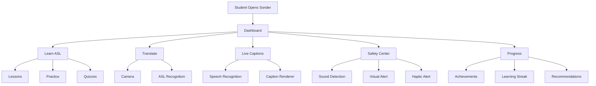
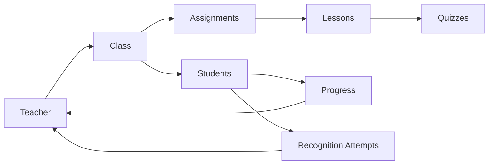
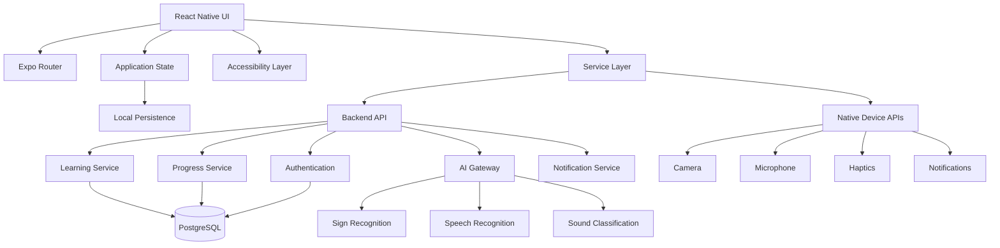
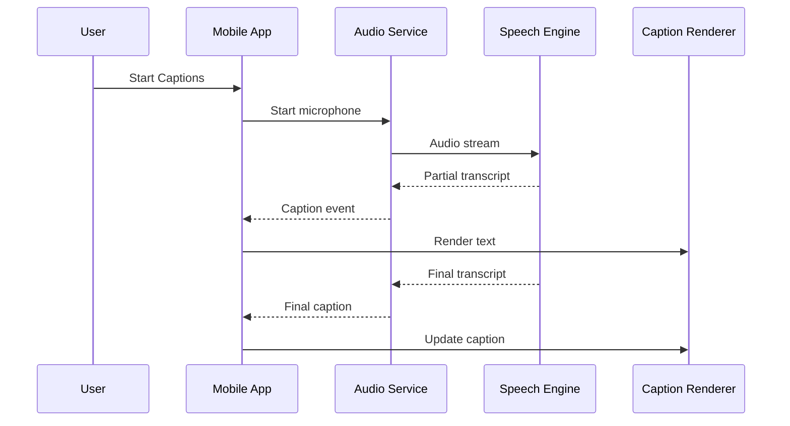
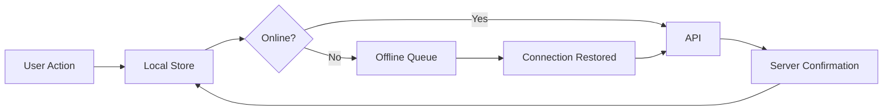
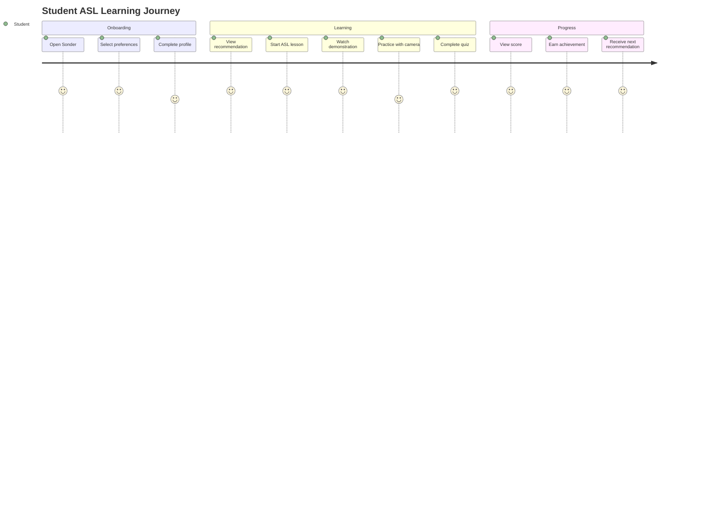
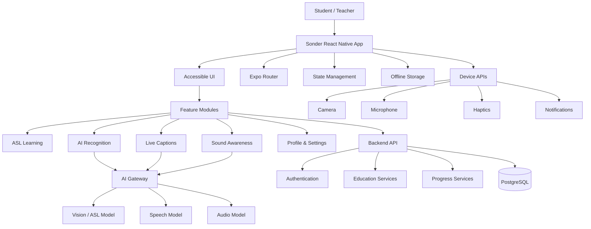

# Sonder 🌎🤟

### Accessible ASL Learning, AI-Assisted Communication & Environmental Awareness

> **Sonder** is a React Native mobile accessibility and education platform designed to help Deaf and hard-of-hearing learners access ASL education, live captions, AI-assisted sign practice, personalized learning, and multimodal environmental awareness from a single mobile application.

---

## Table of Contents

* [Overview](#overview)
* [Vision](#vision)
* [Problem](#problem)
* [Solution](#solution)
* [Core Features](#core-features)
* [Application Architecture](#application-architecture)
* [Technical Architecture](#technical-architecture)
* [Mobile Architecture](#mobile-architecture)
* [AI/ML Architecture](#aiml-architecture)
* [ASL Recognition](#asl-recognition)
* [Live Captions](#live-captions)
* [Sound Awareness](#sound-awareness)
* [Personalized Learning](#personalized-learning)
* [Accessibility](#accessibility)
* [Offline-First Design](#offline-first-design)
* [Data Architecture](#data-architecture)
* [Security & Privacy](#security--privacy)
* [Project Structure](#project-structure)
* [Installation](#installation)
* [Development](#development)
* [Environment Variables](#environment-variables)
* [Testing](#testing)
* [Performance](#performance)
* [Deployment](#deployment)
* [Roadmap](#roadmap)
* [Future AI Infrastructure](#future-ai-infrastructure)
* [Contributing](#contributing)
* [License](#license)

---

# Overview

Sonder is designed around a simple principle:

> **Accessibility should be built into the experience, not added afterward.**

The application combines educational tools and assistive technologies into a unified mobile experience.

The platform is designed around three major pillars:

```text
┌────────────────────────────────────────────────────┐
│                      SONDER                         │
├────────────────────┬──────────────────┬────────────┤
│                    │                  │            │
│    EDUCATION       │   TRANSLATION    │   SAFETY   │
│                    │                  │            │
│  ASL Lessons       │  ASL Practice    │  Sound     │
│  Vocabulary        │  Live Captions   │  Alerts    │
│  Quizzes           │  Speech → Text   │  Haptics   │
│  Progress          │  AI Assistance   │  Visuals   │
│                    │                  │            │
└────────────────────┴──────────────────┴────────────┘
```

Sonder is built with React Native and Expo so that the application can share a large portion of its codebase across iOS and Android.

---

# Vision

Sonder aims to create a more inclusive learning environment where Deaf and hard-of-hearing students can access:

* ASL education
* personalized learning
* visual communication
* live captions
* AI-assisted practice
* environmental awareness
* accessible notifications
* teacher collaboration
* offline learning

The long-term goal is to create an accessibility platform rather than a single-purpose translation application.

---

# Problem

Many accessibility experiences are fragmented.

A student may need separate tools for:

* learning ASL
* accessing captions
* practicing communication
* receiving environmental alerts
* communicating with teachers
* monitoring educational progress

Sonder brings these experiences together.

The application is particularly focused on visual-first interaction.

Instead of depending exclusively on:

```text
Sound
```

Sonder can communicate through:

```text
Text
Visual Indicators
Icons
Haptics
Animations
Color + Labels
```

---

# Solution

Sonder provides a unified mobile experience.



---

# Core Features

## 🎓 ASL Learning

Students can access structured ASL learning content.

Features include:

* lesson categories
* vocabulary
* demonstrations
* practice sessions
* quizzes
* scoring
* completion tracking
* learning streaks
* achievements
* recommendations

---

## 🤖 AI-Assisted ASL Practice

The camera experience provides a foundation for future machine-learning integration.

The current architecture supports:

* camera preview
* recognition session
* scanning state
* detected sign
* confidence score
* feedback
* retry
* recognition history

Example:

```text
┌─────────────────────────────┐
│                             │
│       CAMERA PREVIEW        │
│                             │
│          ✋                 │
│                             │
│      Scanning...            │
│                             │
├─────────────────────────────┤
│ Possible Sign               │
│                             │
│ HELLO                       │
│                             │
│ Confidence: 82%             │
│                             │
│ [ Try Again ]               │
└─────────────────────────────┘
```

The architecture deliberately separates recognition from the user interface so that a real ML model can replace the mock implementation later.

---

# 📝 Live Captions

Sonder provides a visual-first live caption interface.

Features include:

* simulated streaming transcription
* caption history
* pause/resume
* adjustable font size
* contrast controls
* background opacity
* speaker indicators
* caption preferences

Example:

```text
┌──────────────────────────────────┐
│             LIVE                 │
│                                  │
│  Speaker                         │
│                                  │
│  Welcome everyone.               │
│  Today we are learning           │
│  something new.                  │
│                                  │
│             [ Pause ]             │
└──────────────────────────────────┘
```

The caption renderer is intentionally isolated from the speech-recognition service.

---

# 🔊 Sound Awareness

The Safety Center provides an architecture for environmental sound classification.

Potential sound categories include:

* fire alarm
* siren
* car horn
* dog bark
* baby cry
* appliance alerts

The system can produce:

```text
Sound Event
     ↓
Confidence
     ↓
Alert Engine
     ↓
┌──────────┬──────────┬────────────┐
│ Visual   │ Haptic   │ Notification│
└──────────┴──────────┴────────────┘
```

### Important Safety Principle

Sound detection should be treated as an assistive feature.

It should **not** be represented as a guaranteed safety or emergency-detection system.

A model can miss or misclassify sounds.

---

# 📊 Personalized Learning

Sonder contains a foundation for personalized education.

The recommendation system can consider:

```text
Quiz Scores
     +
Completed Lessons
     +
Practice Frequency
     +
Vocabulary Difficulty
     +
Recent Activity
     ↓
Recommendation Engine
     ↓
Next Best Lesson
```

Example:

```text
Recommended for You

⭐ Review: Greetings

Reason:
Your recent quiz shows that
this vocabulary could use more practice.

[ Practice Now ]
```

---

# 🏆 Gamification

The application can track:

* daily streak
* lessons completed
* quizzes completed
* vocabulary mastered
* practice sessions
* achievements
* weekly goals

Example:

```text
THIS WEEK

████████████░░ 86%

Lessons       5
Practice      32 min
Quiz Score    91%

🔥 7 Day Streak
```

Gamification should encourage learning rather than pressure users into excessive usage.

---

# 👩‍🏫 Teacher Experience

Sonder includes an architecture for teacher functionality.

Teachers can eventually:

* create classes
* assign lessons
* monitor progress
* create assignments
* review student results
* provide feedback

Architecture:



---

# Application Architecture

The mobile application uses a modular feature-oriented architecture.

```text
src/
│
├── app/
│   ├── _layout.tsx
│   ├── index.tsx
│   ├── onboarding/
│   ├── lessons/
│   ├── translate/
│   ├── captions/
│   ├── safety/
│   ├── profile/
│   └── settings/
│
├── components/
│   ├── Button/
│   ├── Card/
│   ├── Progress/
│   ├── Caption/
│   └── Accessibility/
│
├── features/
│   ├── auth/
│   ├── learning/
│   ├── recognition/
│   ├── captions/
│   ├── safety/
│   └── personalization/
│
├── services/
│   ├── api/
│   ├── recognition/
│   ├── captions/
│   ├── sound/
│   └── notifications/
│
├── store/
│
├── hooks/
│
├── types/
│
├── constants/
│
└── utils/
```

This prevents the application from becoming a monolithic collection of screens.

---

# Technical Architecture



---

# Mobile Architecture

The mobile application follows a layered architecture.

## Presentation Layer

Responsible for:

* screens
* components
* navigation
* animations
* accessibility

## State Layer

Responsible for:

* user session
* preferences
* current lesson
* recognition state
* caption state
* safety state

## Service Layer

Responsible for:

* API requests
* AI calls
* notifications
* local persistence
* device integrations

## Data Layer

Responsible for:

* local cache
* synchronization
* API models
* persistent data

---

# State Management

Sonder should distinguish between UI state and server state.

Example:

```text
UI State

isCaptionPaused
isScanning
isModalOpen
selectedTab
```

versus:

```text
Server State

user
lessons
progress
quizResults
recognitionHistory
```

A state architecture can be represented as:

```text
             APPLICATION
                  │
        ┌─────────┴─────────┐
        │                   │
    Local State         Server State
        │                   │
     Zustand           Query Cache
        │                   │
        └─────────┬─────────┘
                  │
             Components
```

---

# AI/ML Architecture

The application should keep AI models behind stable service interfaces.

```text
Mobile Application
        │
        ▼
    AI Gateway
        │
 ┌──────┼─────────┐
 │      │         │
Sign   Speech    Sound
 │      │         │
Model  Model     Model
```

This architecture makes it possible to change models without rewriting the entire application.

---

# ASL Recognition

The recognition pipeline can evolve through three stages.

## Stage 1 — Mock Recognition

```text
Camera
 ↓
Mock Recognition Service
 ↓
Prediction
 ↓
UI
```

This is ideal for an MVP.

## Stage 2 — Cloud Recognition

```text
Camera
 ↓
Frame Processing
 ↓
Recognition API
 ↓
ML Model
 ↓
Prediction
```

## Stage 3 — Hybrid / On-Device

```text
Camera
 ↓
Local Preprocessing
 ↓
On-device Model
 ↓
Prediction

        │
        └── Optional Cloud Enhancement
```

On-device inference can reduce latency and reduce the need to transmit camera data.

---

# Recognition Interface

A provider abstraction should be used.

```ts
export interface SignRecognitionProvider {
  recognize(
    input: RecognitionInput
  ): Promise<RecognitionResult>;
}
```

Example result:

```ts
export interface RecognitionResult {
  label: string;
  confidence: number;
  timestamp: number;
}
```

A mock implementation:

```ts
export class MockSignRecognitionProvider
  implements SignRecognitionProvider {

  async recognize(): Promise<RecognitionResult> {
    return {
      label: "HELLO",
      confidence: 0.82,
      timestamp: Date.now(),
    };
  }
}
```

The UI does not need to know whether the prediction came from a mock provider or a real model.

---

# Live Caption Architecture



The application should distinguish between:

```text
Partial Transcript
```

and:

```text
Final Transcript
```

This makes the caption experience feel more natural.

---

# Sound Detection Architecture

```text
Microphone
    │
    ▼
Audio Buffer
    │
    ▼
Feature Extraction
    │
    ▼
Sound Classifier
    │
    ▼
Confidence Threshold
    │
    ▼
Sound Event
    │
    ▼
Alert Manager
    │
 ┌──┼────────────┐
 ▼  ▼            ▼
UI Haptic   Notification
```

The confidence threshold should be configurable by the detection system.

---

# Accessibility Architecture

Accessibility is a first-class application service.

```text
Accessibility Preferences
          │
 ┌────────┼──────────────┐
 ▼        ▼              ▼
Typography Contrast   Motion
 │        │              │
 └────────┼──────────────┘
          ▼
     UI Components
```

Supported preferences can include:

* larger text
* high contrast
* reduced motion
* haptics
* caption preferences
* color-friendly mode
* visual alerts
* notification preferences

---

# Accessibility Principles

Sonder should follow these principles:

### 1. Never rely exclusively on sound

Important information should have a visual alternative.

### 2. Never rely exclusively on color

Use:

```text
Color + Icon + Text
```

instead of color alone.

### 3. Keep language simple

Prefer:

> Start Practice

over:

> Initiate Recognition Session

### 4. Use readable typography

Avoid unnecessary decorative typography.

### 5. Support adjustable interfaces

Users should have control over:

* text size
* contrast
* motion
* captions
* alerts

---

# Offline-First Design

Sonder should continue functioning when connectivity is unavailable.



Offline-capable data can include:

* downloaded lessons
* vocabulary
* quiz content
* progress
* accessibility preferences
* recent activity

---

# Synchronization

Each locally generated operation can contain:

```ts
interface SyncOperation {
  id: string;
  type: string;
  payload: unknown;
  createdAt: number;
  retryCount: number;
}
```

The synchronization system should:

1. write locally
2. enqueue operation
3. detect connectivity
4. send operation
5. verify server response
6. mark operation synchronized

This avoids forcing students to manually repeat actions after connectivity interruptions.

---

# Data Architecture

A conceptual database:

```text
users
 │
 ├── profiles
 ├── accessibility_preferences
 ├── lesson_progress
 ├── quiz_attempts
 ├── recognition_sessions
 └── notifications

courses
 │
 └── lessons
      │
      ├── vocabulary
      ├── exercises
      └── quizzes

teachers
 │
 └── classes
      │
      ├── enrollments
      └── assignments
```

---

# Example Database Model

```sql
CREATE TABLE lesson_progress (
    id UUID PRIMARY KEY,
    user_id UUID NOT NULL,
    lesson_id UUID NOT NULL,
    progress INTEGER NOT NULL DEFAULT 0,
    score INTEGER,
    completed BOOLEAN DEFAULT FALSE,
    started_at TIMESTAMP,
    completed_at TIMESTAMP
);
```

The actual production schema should additionally include appropriate indexes, foreign keys, timestamps, and authorization policies.

---

# API Architecture

The backend should use versioned endpoints.

```text
/api/v1/auth
/api/v1/users
/api/v1/lessons
/api/v1/progress
/api/v1/quizzes
/api/v1/recognition
/api/v1/captions
/api/v1/sounds
/api/v1/notifications
```

Example:

```http
GET /api/v1/lessons
```

```http
GET /api/v1/lessons/:id
```

```http
POST /api/v1/progress
```

```http
POST /api/v1/recognition
```

```http
POST /api/v1/captions/session
```

---

# API Response Pattern

Use predictable responses.

```json
{
  "success": true,
  "data": {
    "id": "lesson-001",
    "title": "ASL Greetings"
  }
}
```

Errors:

```json
{
  "success": false,
  "error": {
    "code": "LESSON_NOT_FOUND",
    "message": "The requested lesson could not be found."
  }
}
```

---

# Security & Privacy

Sonder may interact with sensitive information such as:

* educational progress
* camera data
* microphone data
* user profiles
* accessibility preferences

Security should therefore be designed into the architecture.

Recommended principles:

```text
Data Minimization
        ↓
Secure Transport
        ↓
Authentication
        ↓
Authorization
        ↓
Validation
        ↓
Audit Logging
```

---

# Camera Privacy

Where possible:

```text
Camera
  ↓
Local Processing
  ↓
Prediction
```

rather than:

```text
Camera
  ↓
Upload Raw Video
  ↓
Server
```

Raw video should not be retained unnecessarily.

---

# Audio Privacy

Similarly, audio processing should minimize retention.

```text
Audio
 ↓
Temporary Buffer
 ↓
Recognition
 ↓
Discard Unnecessary Raw Data
```

Any production implementation should define clear data-retention policies and obtain appropriate permissions and consent.

---

# Authentication

Authentication should be abstracted from the UI.

```text
Login Screen
     │
     ▼
Auth Service
     │
     ▼
Backend
     │
     ▼
Session
     │
     ▼
Secure Device Storage
```

Do not place authentication tokens directly into arbitrary application state or plaintext files.

---

# Project Structure

Recommended complete structure:

```text
Sonder/
│
├── src/
│   ├── app/
│   ├── components/
│   ├── features/
│   │   ├── auth/
│   │   ├── learning/
│   │   ├── recognition/
│   │   ├── captions/
│   │   ├── safety/
│   │   └── personalization/
│   │
│   ├── services/
│   │   ├── api/
│   │   ├── ai/
│   │   ├── captions/
│   │   ├── sound/
│   │   └── notifications/
│   │
│   ├── store/
│   ├── hooks/
│   ├── types/
│   ├── constants/
│   └── utils/
│
├── assets/
├── tests/
├── app.json
├── package.json
├── tsconfig.json
└── README.md
```

---

# Installation

## Prerequisites

Install:

* Node.js
* npm
* Git
* Expo tooling
* iOS Simulator or Android Emulator for local testing

Clone the repository:

```bash
git clone <YOUR_REPOSITORY_URL>
cd Sonder
```

Install dependencies:

```bash
npm install
```

Start development:

```bash
npx expo start
```

Then select the appropriate development target.

---

# Development Commands

Typical commands:

```bash
npm start
```

```bash
npx expo start
```

```bash
npm run lint
```

```bash
npm test
```

```bash
npx tsc --noEmit
```

Before submitting changes, verify:

```text
✓ TypeScript
✓ Lint
✓ Tests
✓ Navigation
✓ Offline behavior
✓ Accessibility
✓ Permissions
```

---

# Environment Variables

Example:

```env
EXPO_PUBLIC_API_URL=https://api.example.com
EXPO_PUBLIC_ENVIRONMENT=development
```

Never commit:

```text
API secrets
Private keys
Database passwords
Production credentials
```

Use environment-specific secret management for production infrastructure.

---

# Mock Data

The MVP should operate without requiring production AI infrastructure.

Example:

```ts
export const mockLessons = [
  {
    id: "lesson-001",
    title: "ASL Greetings",
    level: "beginner",
    progress: 0.8,
  },
  {
    id: "lesson-002",
    title: "Everyday Conversations",
    level: "beginner",
    progress: 0.35,
  },
];
```

Mock data allows the complete application flow to be demonstrated before expensive backend services are connected.

---

# Testing Strategy

Testing should occur at multiple levels.

## Unit Tests

Test:

* quiz scoring
* progress calculations
* recommendation logic
* recognition thresholds
* notification routing
* synchronization

## Component Tests

Test:

* buttons
* cards
* lesson components
* caption renderer
* recognition result
* safety alert

## Integration Tests

Test:

```text
Login
 ↓
Dashboard
 ↓
Lesson
 ↓
Practice
 ↓
Quiz
 ↓
Progress
```

## Device Tests

Test:

* iOS
* Android
* small screens
* large screens
* offline mode
* camera permissions
* microphone permissions
* notification permissions
* large text
* reduced motion
* high contrast

---

# Performance

Performance priorities include:

### Camera

Avoid unnecessary re-renders during camera sessions.

### Lists

Use optimized list rendering for:

* lessons
* vocabulary
* history
* notifications

### Images

Use appropriately sized assets.

### Network

Cache:

* lessons
* user profile
* progress
* vocabulary

### AI

Avoid sending unnecessary frames to remote services.

---

# Error Handling

Every major feature should have:

```text
Loading
Success
Empty
Error
Offline
Permission Denied
Retry
```

Example:

```text
┌─────────────────────────────┐
│ Something went wrong.       │
│                             │
│ We couldn't load this       │
│ lesson right now.           │
│                             │
│       [ Try Again ]         │
└─────────────────────────────┘
```

Never leave the user staring at a blank screen.

---

# Permissions

Features that require device permissions should request them contextually.

Examples:

```text
Camera → ASL Practice
Microphone → Live Captions
Microphone → Sound Awareness
Notifications → Alerts
```

The application should explain why the permission is needed before requesting it where appropriate.

---

# Production Deployment

The release process should eventually include:

```text
Development
    ↓
QA
    ↓
Internal Testing
    ↓
Beta
    ↓
Accessibility Review
    ↓
Security Review
    ↓
Production
```

Before release:

* test on physical devices
* verify permissions
* verify offline functionality
* verify accessibility
* verify crash handling
* verify privacy disclosures
* verify app-store metadata

---

# Roadmap

## Phase 1 — MVP

* [x] React Native foundation
* [x] Expo
* [x] TypeScript
* [x] Navigation
* [x] Dashboard
* [x] ASL lessons
* [x] Quizzes
* [x] Progress
* [x] Mock recognition
* [x] Mock captions
* [x] Mock sound detection

## Phase 2 — Accessibility

* [ ] Advanced accessibility settings
* [ ] Offline lesson downloads
* [ ] Enhanced caption customization
* [ ] Improved haptic feedback
* [ ] Expanded visual notification system

## Phase 3 — AI

* [ ] Real ASL recognition
* [ ] Speech recognition
* [ ] Sound classification
* [ ] AI learning assistant
* [ ] Personalized recommendations

## Phase 4 — Education

* [ ] Teacher accounts
* [ ] Classes
* [ ] Assignments
* [ ] Teacher feedback
* [ ] Student analytics

## Phase 5 — Platform

* [ ] Cloud synchronization
* [ ] Advanced analytics
* [ ] Wearable integrations
* [ ] More languages
* [ ] Expanded ASL vocabulary
* [ ] On-device inference

---

# Future AI Infrastructure

The long-term architecture can support multiple AI providers.

```text
                    AI Gateway
                        │
          ┌─────────────┼──────────────┐
          │             │              │
      Vision Model   Speech Model   Audio Model
          │             │              │
       ASL AI       Caption AI      Sound AI
```

A provider abstraction prevents the application from becoming dependent on one model provider.

---

# AI Evaluation

AI predictions should be evaluated using:

```text
Accuracy
Precision
Recall
Latency
Confidence Calibration
False Positives
False Negatives
```

For educational features, evaluation should also consider:

```text
Age appropriateness
Learning usefulness
Feedback quality
Accessibility
User comprehension
```

---

# Responsible AI

Sonder should avoid presenting uncertain AI predictions as facts.

Instead of:

```text
"You signed HELLO."
```

when confidence is low:

```text
"Possible match: HELLO"

"Try again with your hand centered
in the camera."
```

AI should augment the user's experience rather than replace human teachers or professional interpreters.

---

# Design Philosophy

Sonder's design language should feel:

```text
Accessible
Modern
Friendly
Visual
Calm
Simple
Trustworthy
```

Avoid unnecessary interface complexity.

The application should prioritize:

```text
Clarity > Decoration
Accessibility > Novelty
Reliability > Complexity
User Control > Automation
```

---

# Example User Journey



---

# Example Accessibility Journey

```text
User
 │
 ▼
Open Safety Center
 │
 ▼
Enable Detection Mode
 │
 ▼
Environmental Sound Detected
 │
 ▼
Confidence Evaluation
 │
 ▼
Visual Alert
 │
 ├── Text
 ├── Icon
 └── Screen Indicator
 │
 ▼
Optional Haptic Alert
```

The feature should always communicate that automated sound recognition can be imperfect.

---

# Why React Native?

React Native is a strong fit because Sonder needs:

* mobile-first UX
* camera access
* microphone access
* notifications
* haptics
* persistent storage
* cross-platform development
* rapid iteration

Using Expo further simplifies development and deployment while retaining the ability to introduce native functionality as the application grows.

---

# Why TypeScript?

TypeScript provides stronger guarantees around:

* API responses
* navigation parameters
* recognition results
* lesson models
* user profiles
* accessibility settings
* synchronization events

For an application with multiple AI and device integrations, strong typing substantially reduces integration mistakes.

---

# Why a Service-Oriented Architecture?

Instead of embedding AI logic directly into screens:

```text
Bad:

Screen
 ├── Camera
 ├── API
 ├── AI
 ├── Database
 └── UI
```

Sonder should use:

```text
Screen
  │
  ▼
Feature
  │
  ▼
Service
  │
  ▼
Provider
```

This makes it easier to replace:

```text
Mock AI
```

with:

```text
Real AI
```

without rewriting the interface.

---

# MVP Definition of Done

The initial production-quality MVP should satisfy:

```text
[✓] App launches
[✓] Navigation works
[✓] Dashboard works
[✓] Lessons work
[✓] Quizzes work
[✓] Progress persists
[✓] Camera practice works with mock AI
[✓] Captions work with simulated data
[✓] Sound alerts work with mock events
[✓] Accessibility settings work
[✓] Offline state works
[✓] Loading states work
[✓] Error states work
[✓] No TypeScript errors
[✓] No broken routes
[✓] No dead buttons
```

---

# Future Vision

Sonder can eventually evolve from an educational mobile application into a broader accessibility platform.

Potential future areas include:

```text
ASL Education
      +
AI Translation
      +
Live Captions
      +
Environmental Awareness
      +
Teacher Collaboration
      +
Wearables
      +
On-device AI
      +
Personalized Education
```

The ultimate architecture should remain modular enough that each capability can evolve independently.

---

# Contributing

Contributions are welcome.

Recommended workflow:

```bash
git checkout -b feature/my-feature
```

Make changes.

Run:

```bash
npm run lint
npx tsc --noEmit
npm test
```

Then commit:

```bash
git add .
git commit -m "feat: improve accessibility settings"
```

Push:

```bash
git push origin feature/my-feature
```

Open a pull request.

---

# Contribution Guidelines

When adding a feature:

1. Keep business logic outside UI components.
2. Add TypeScript types.
3. Add loading and error states.
4. Consider offline behavior.
5. Consider accessibility.
6. Avoid unnecessary dependencies.
7. Add tests where practical.
8. Do not commit secrets.
9. Document new services.
10. Verify the application on a physical device when device APIs are involved.

---

# Security Principles

Sonder follows a security-by-design approach.

```text
Least Privilege
Data Minimization
Secure Storage
Encrypted Transport
Input Validation
Authorization
Auditability
```

Security should be continuously reviewed as AI, education, and device integrations expand.

---

# Product Principles

Sonder is guided by five principles:

### 1. Inclusion

Technology should reduce barriers rather than create new ones.

### 2. Simplicity

Users should understand what to do without extensive instructions.

### 3. Transparency

AI predictions should communicate uncertainty.

### 4. Privacy

Camera and microphone capabilities should minimize unnecessary data collection.

### 5. User Control

Accessibility preferences should belong to the user.

---

# Final Architecture



---

# Conclusion

Sonder is designed to demonstrate how mobile technology, accessibility, education, and artificial intelligence can be combined into one cohesive experience.

The most important architectural decision is **modularity**.

The application should not depend directly on a particular AI model, backend provider, or database implementation.

Instead:

```text
React Native
     ↓
Feature Layer
     ↓
Service Layer
     ↓
Provider Layer
```

This allows the platform to evolve from a mock-data MVP into a production application with:

* real ASL recognition
* real-time speech recognition
* environmental sound classification
* personalized education
* teacher collaboration
* offline learning
* on-device AI
* wearable integrations

Sonder's long-term goal is not simply to translate communication.

It is to make digital learning and everyday mobile interaction **more accessible, visual, understandable, and user-controlled**.

---

## Built With

* React Native
* Expo
* TypeScript
* Expo Router
* React
* Local persistence
* REST APIs
* PostgreSQL
* Machine Learning
* Computer Vision
* Speech Recognition
* Audio Classification

---

## Project Status

**Status:** 🚧 Active Development

**Current Target:** Production-quality React Native MVP

**Primary Platforms:** iOS + Android

**Architecture:** Mobile-first, modular, AI-ready, offline-aware

---

## License

Add the project's chosen license here, for example:

```text
MIT License
```

or another license appropriate for the project's distribution model.

---

# ⭐ Sonder

**Accessible education. AI-assisted communication. A more inclusive mobile experience.**

> *Built with accessibility at the center.*
